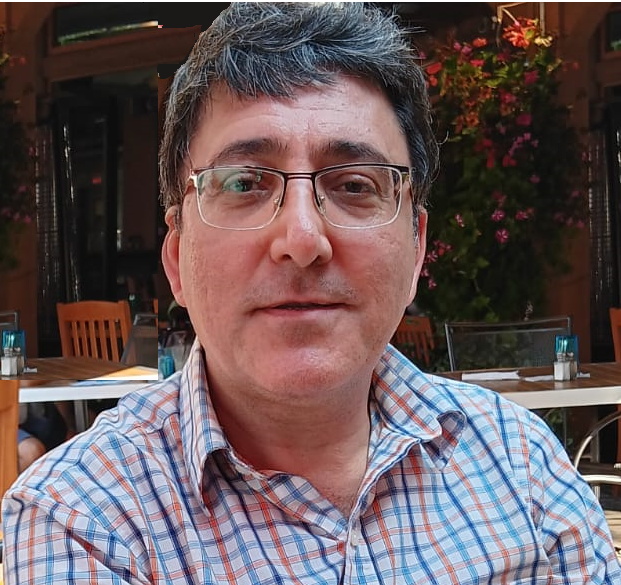

+++
title = "Home"
description = "Professional math tutoring by Dr. Sam Azizi, Ph.D. School and university math in Vancouver, Burnaby, Coquitlam, Surrey and online."
template = "index.html"
+++

# Expert Math Tutor For School And University

## Professional School Math Tutor for Grades 1 to 12

## Experienced Math Tutor for University Students from Freshman to Senior Year

Hello and welcome! I'm **Dr. Sam Azizi**, a highly experienced professional math tutor with a Ph.D. in mathematics, offering private math tutoring. To maintain the high quality of tutoring, I have no employees — all tutoring is done by me alone. Each year I accept a short list of students for [school math tutoring](/school-math/) and [university math tutoring](/university-math/) from grade one through the last year of university.

### School Math Tutoring & Entrance Exams

- [School Math Tutoring Grades 1 to 12, including IB and AP programs](/school-math/)
- [Pre-Calculus 11 & Pre-Calculus 12 Tutoring](/pre-calculus/)
- [Calculus, AP Calculus & IB Calculus Tutoring](/calculus-courses/)
- [SSAT Tutoring](/ssat/), [SAT / PSAT / ACT Tutoring](/sat/)
- Math competitions tutoring

### University Math Tutoring & Entrance Exams

- [Calculus I, II, III & IV Tutoring](/calculus-courses/)
- [Linear Algebra & Matrix Algebra Tutoring](/linear-algebra/)
- [Differential Equations Tutoring](/differential-equations/)
- [Discrete Mathematics Tutoring](/discrete-math/)
- [GMAT & GRE Tutoring](/gmat/)

### UBC Math Tutoring

[UBC Math Courses](/ubc/) including Math 100, 101, 102, 103, 104, 105, 110, 120, 152, 180, 184, 200, 215, 220, 221, 253, 255, 256, 300, 305, 307, 317 and CPSC 121.

### SFU Math Tutoring

[SFU Math Courses](/sfu/) including Math 100, 150, 151, 152, 154, 155, 157, 158, 232, 240, 251, 340 and MACM 101.

### About Me

- Full Professor of Mathematics with a Ph.D. in Math
- 15 years of experience as a full-time university faculty member
- 12+ years of full-time math tutoring across school (grades 4–12), college, and university courses
- Experienced tutor for entrance exams (GMAT, GRE, SAT, SSAT)

### Tutoring Rates (promotional)

- **One-on-one tutoring:** $50–$60 per hour
- **10-hour package (5 sessions):** $500
- Group rates available — contact me for details

Rates depend on course level, difficulty, and appointment date.

---

### Contact Dr. Sam Azizi

- **Phone / SMS:** [+1 (778) 882-4636](tel:+17788824636)
- **WhatsApp:** [Chat on WhatsApp](https://wa.me/17788824636)
- **Telegram:** [Message on Telegram](https://t.me/bestmathtuor)
- **Email:** [tutor@bestmathtutor.ca](mailto:tutor@bestmathtutor.ca)

*Please do not hesitate to contact me for details and current availability.*
