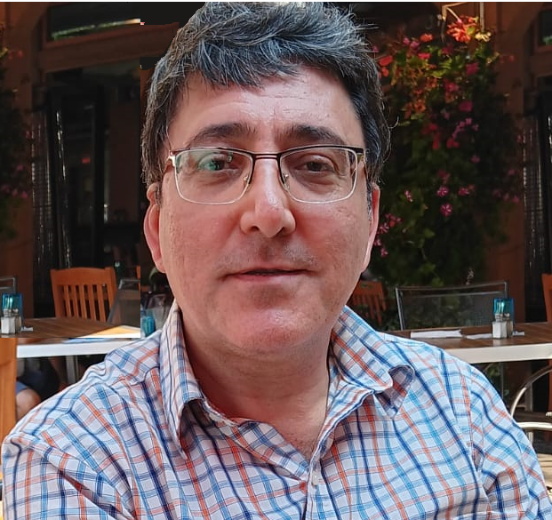

+++
title = "School Math Tutoring"
description = "Math Tutoring By Math Ph.D. For Schools Math Tutoring From Grade 4 up to Grade 12 Including Calculus, AP Calculus, IB program, and Entrance Exams."
date = 2019-01-07
template = "page.html"
+++
# Expert Math Tutor For School

## Professional Math Tutor for Grades 1 to 12

## In detail, I tutor:

### [School Math Tutoring Grades 1 to 12, Including IB And AP Programs, And Math Competitions](/school-math/)

### A list of the school math tutoring courses (not limited to) that I tutor is as follows:

 	- ### [Calculus Tutoring](/calculus-courses/)

 	- ### [AP Calculus Tutoring](/calculus-courses/)

 	- ### IB Math Tutoring

 	- ### [Pre-Calculus 12 Tutoring](/pre-calculus/)

 	- ### [Pre-Calculus 11 Tutoring](/pre-calculus/)

 	- ### Math Foundation 12 Tutoring

 	- ### Math Foundation 11 Tutoring

 	- ### [Math 10 Tutoring](/math10/)

 	- ### [Math 9 Tutoring](/math9/)

 	- ### [Math 8 Tutoring](/math8/)

 	- ### [Math 7 Tutoring](/math7/)

 	- ### Math 6 Tutoring

 	- ### Math 5 Tutoring

 	- ### Math 4 Tutoring

 	- ### Math 3 Tutoring

 	- ### Math 2 Tutoring

 	- ### Math 1 Tutoring

 	- ### Trachtenberg System For Fast Mental Math Computation

### Entrance Exams Tutoring, Including:

 	- ## [SSAT Tutoring, SAT Tutoring, PSAT Tutoring and ACT Tutoring](/gmat/)

###

## Contact Me:

## Dr. Sam Azizi

#### Please do not hesitate to contact me for details!

#### ☎️ Contact Number: [+1 (778) 882-4636](tel:+1-778-882-4636)

#### [WhatsApp](https://wa.me/+1 (778) 882-4636)[+1 (778) 882-4636](https://wa.me/+1 (778) 882-4636)

#### [Telegram](https://t.me/bestmathtuor)[+1 (778) 882-4636](https://t.me/bestmathtuor)

#### 📩 Email: [tutor@bestmathtutor.ca](mailto:tutor@bestmathtutor.ca)

## If you are looking for the best math tutor to improve your math skills, better understand math, and raise your math grades, at a reasonable price, then you are in the right place!

## [Read My Students' Testimonials](https://www.google.ca/search?sca_esv=e8f1a2605d183bd5&sxsrf=AE3TifMv9rdMOv5I65crkgxVYzQmzL46dw%3A1758443290926&kgmid=%2Fg%2F11xfj2trbh&q=Best%20Math%20Tutor&shndl=30&source=sh%2Fx%2Floc%2Fact%2Fm4%2F2#lkt=LocalPoiReviews&lpg=cid:CgIgAQ%3D%3D&ebo=0&mpd=~8612954167688634802/customers/reviews)

## About Me: Dr. Sam Azizi:

 Best Math Tutor

 	- ### Full Professor Of Mathematics With A Ph.D. In Math

 	- ### 15 Years Of Experience As A Full-Time University Faculty

 	- ### 15 Years Of Experience in Full-Time Math Tutoring a Very Broad Range of School Math Courses, Including Calculus, AP Calculus, IB Math Courses, School Math Grades 1 to 12.

 	- ### A Knowledgeable Math Tutor for Entrance Exams such as  [SAT, SSAT, PSAT, ACT](/sat/).

###

###

### MATH TUTORING RATES:

## Temporary promotional tutoring rates:

 	- ### One-On-One Tutoring: $50 to $60 per hour.

 	- ### 10 hours (5 sessions) Package: $500.

 	- ### Group of 6 People: Saturdays 3 pm-4 pm (PST): $12 Per Person.

#### The detail rates depend on the course level, difficulty, and appointment date! Please do not hesitate to contact me for details!

#### ☎️ Contact Number: [+1 (778) 882-4636](tel:+1-778-882-4636)

#### [WhatsApp](https://wa.me/+1 (778) 882-4636)[+1 (778) 882-4636](https://wa.me/+1 (778) 882-4636)

#### [Telegram](https://t.me/bestmathtuor)[+1 (778) 882-4636](https://t.me/bestmathtuor)

#### 📩 Email: [tutor@bestmathtutor.ca](mailto:tutor@bestmathtutor.ca)

