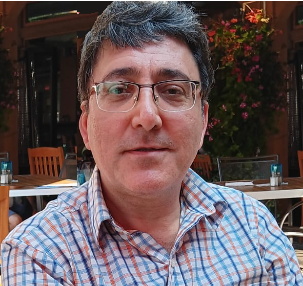

+++
title = "University Math Tutoring"
description = "Math tutoring by a Math Ph.D. for university courses including Calculus, Linear Algebra, Differential Equations, Discrete Math, GMAT and GRE."
date = 2023-08-28
template = "page.html"
+++

# University Math Tutoring

In detail, I tutor university math including:

- [Calculus I, II, III & IV Tutoring](/calculus-courses/)
- [Linear Algebra Tutoring](/linear-algebra/)
- [Matrix Algebra Tutoring](/linear-algebra/)
- [Differential Equations Tutoring](/differential-equations/)
- [Discrete Mathematics Tutoring](/discrete-math/)
- Entrance exams: [GMAT & GRE Tutoring](/gmat/)

## About Me: Dr. Sam Azizi

- Full Professor of Mathematics with a Ph.D. in Math
- 15 years of experience as a full-time university faculty member
- 12+ years of full-time math tutoring across a broad range of school, college, and university courses
- Knowledgeable tutor for entrance exams (GMAT, GRE)

### UBC Math Tutoring

My UBC courses include: [Math 100](/ubc-math-100/), [101](/ubc-math-101/), [102](/ubc-math-102/), [103](/ubc-math-103/), [104](/ubc-math-104/), [105](/ubc-math-105/), [110](/ubc-math-110/), [120](/ubc-math-120-tutoring/), [CPSC 121](/ubc-cpsc-121-tutoring/), [152](/ubc-math-152/), [180](/ubc-math-180/), [184](/ubc-math-184/), [200](/ubc-math-200/), [215](/ubc-math-215/), [220](/ubc-math-220/), [221](/ubc-math-221/), [253](/ubc-math-253/), [255](/ubc-math-255/), [256](/ubc-math-256/), [300](/ubc-math-300/), [305](/ubc-math-305-tutoring/), [307](/ubc-math-307-tutoring/), [317](/ubc-math-317/) and more. See the full list on the [UBC Math Tutoring](/ubc/) page.

### SFU Math Tutoring

SFU courses include: [Math 100](/sfu-math-100/), [150](/sfu-math-150/), [151](/sfu-math-151/), [152](/sfu-math-152/), [154](/sfu-math-154/), [155](/sfu-math-155/), [157](/sfu-math-157/), [158](/sfu-math-158/), [232](/sfu-math-232/), [240](/sfu-math-240/), [251](/sfu-math-251/), [340](/sfu-math-340-tutoring/), [MACM 101](/macm-101/). See the [SFU Math Tutoring](/sfu/) page.

I also tutor Capilano University, Langara College, Columbia College, Douglas College, Alexander College, and Coquitlam College math courses.

## Math Tutoring Rates (promotional)

- **One-on-one tutoring:**$50–$60 per hour
- **10-hour package (5 sessions):**$500
- Group of 6 people (Saturdays 3–4 pm PST): $12 per person

Rates depend on course level, difficulty, and appointment date. Please contact me for details.

---

### Contact Dr. Sam Azizi

- **Phone / SMS:** [+1 (778) 882-4636](tel:+17788824636)
- **WhatsApp:** [Chat on WhatsApp](https://wa.me/17788824636)
- **Telegram:** [Message on Telegram](https://t.me/bestmathtuor)
- **Email:** [tutor@bestmathtutor.ca](mailto:tutor@bestmathtutor.ca)
